<picture>
  <source media="(prefers-color-scheme: dark)" srcset="assets/cards/header-dark.svg">
  
</picture>

<!-- live:stats -->

  <picture>
    <source media="(prefers-color-scheme: dark)" srcset="assets/cards/stats-dark.svg">
    
  </picture>

<!-- /live:stats -->

I build software for the way groups in Kenya actually save, lend and talk to their members: SACCOs, chamas and microfinance institutions, M-Pesa, SMS and the credit check before a loan. I'm a full-stack developer at **Wakandi**, working on the Jamii platform, and a Computer Science graduate of **The Co-operative University of Kenya**. Before Wakandi I looked after enterprise access infrastructure as an intern at **Safaricom**.

Security is half of how I think: row-level security, audit trails and fraud controls are part of the job, not an extra. I'm drawn to cybersecurity and fraud detection, AI and Swahili NLP, cloud security and legal tech.

**Next.js · TypeScript · Python · Django · FastAPI · PostgreSQL · Supabase · LangChain · M-Pesa Daraja · Docker**

## What I'm working on now

November 2026

- **Jamii Studio at Wakandi.** A website builder for SACCOs, MFIs and chamas: photos made by an AI image model and checked before they go up, websites written in Kiswahili when chosen, every site at its own address, and stories sent in by members.
- **CRB Lookup at Wakandi.** Real lookup prices in place of placeholders, and the background job moved onto CRB's own route.
- **Expert RN Scholars, Phase 1.** The website and admin dashboard for a NCLEX-RN prep school for nursing graduates.
- **MemberPulse.** My own member register and SMS outreach app for groups that run on their members.

<picture>
  <source media="(prefers-color-scheme: dark)" srcset="assets/cards/journey-dark.svg">
  
</picture>

## Featured work

### At Wakandi, on the Jamii platform

  <picture>
    <source media="(prefers-color-scheme: dark)" srcset="assets/cards/jamii-studio-dark.svg">
    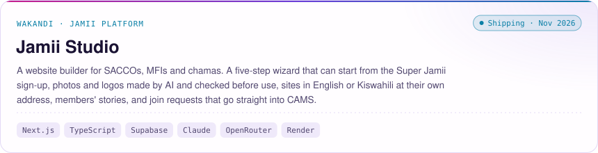
  </picture>

  <picture>
    <source media="(prefers-color-scheme: dark)" srcset="assets/cards/crb-lookup-dark.svg">
    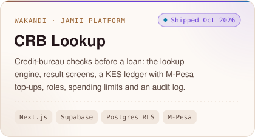
  </picture>
  <picture>
    <source media="(prefers-color-scheme: dark)" srcset="assets/cards/jamii-connect-dark.svg">
    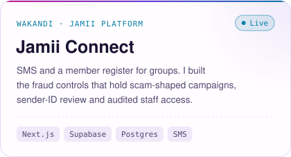
  </picture>

  <picture>
    <source media="(prefers-color-scheme: dark)" srcset="assets/cards/waypoint-dark.svg">
    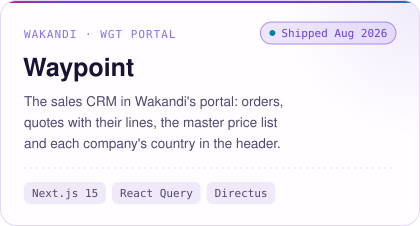
  </picture>
  <picture>
    <source media="(prefers-color-scheme: dark)" srcset="assets/cards/sacco-web-dark.svg">
    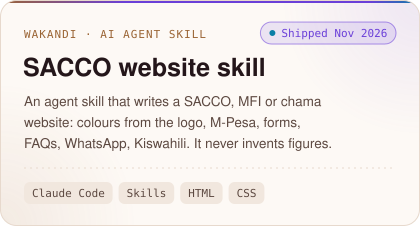
  </picture>

### Personal and client projects

  <picture>
    <source media="(prefers-color-scheme: dark)" srcset="assets/cards/sheria-ai-dark.svg">
    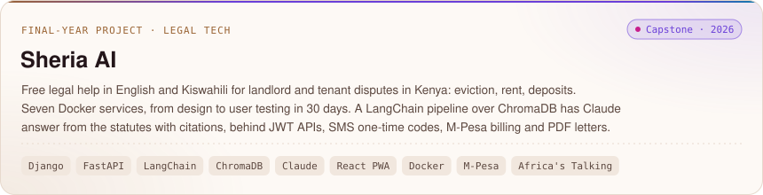
  </picture>

  <picture>
    <source media="(prefers-color-scheme: dark)" srcset="assets/cards/expert-rn-scholars-dark.svg">
    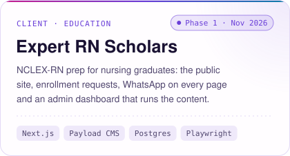
  </picture>
  <picture>
    <source media="(prefers-color-scheme: dark)" srcset="assets/cards/memberpulse-dark.svg">
    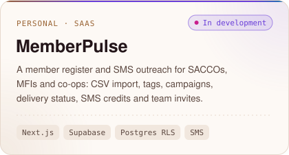
  </picture>

  <picture>
    <source media="(prefers-color-scheme: dark)" srcset="assets/cards/ea-outreach-dark.svg">
    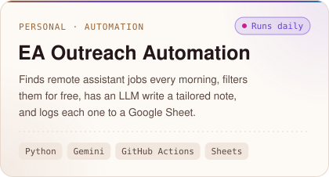
  </picture>
  <a href="https://github.com/Tamonel/jaclang-number-game-beginner-toolkit"><picture>
    <source media="(prefers-color-scheme: dark)" srcset="assets/cards/jaclang-game-dark.svg">
    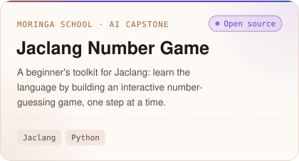
  </picture></a>

Most of this code lives in private repos, for clients and for Wakandi. Ask me for a walkthrough.

## My year in numbers

These count my commits in private repos too, including the ones on Wakandi's own GitHub server, which GitHub's calendar never sees. They refresh every night.

<!-- live:year -->

  <picture>
    <source media="(prefers-color-scheme: dark)" srcset="assets/cards/galaxy-dark.svg">
    
  </picture>

  <picture>
    <source media="(prefers-color-scheme: dark)" srcset="assets/cards/comet-dark.svg">
    
  </picture>

  <picture>
    <source media="(prefers-color-scheme: dark)" srcset="assets/cards/sources-dark.svg">
    
  </picture>
  <picture>
    <source media="(prefers-color-scheme: dark)" srcset="assets/cards/lines-dark.svg">
    
  </picture>

  <picture>
    <source media="(prefers-color-scheme: dark)" srcset="assets/cards/languages-dark.svg">
    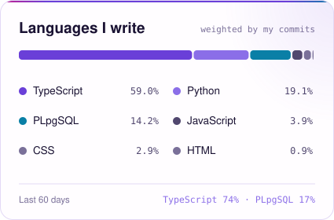
  </picture>
  <picture>
    <source media="(prefers-color-scheme: dark)" srcset="assets/cards/weekdays-dark.svg">
    
  </picture>

<!-- /live:year -->

<b>The last year, month by month</b>

| When | What happened |
| --- | --- |
| Oct 2025 – Apr 2026 | Enterprise infrastructure intern at Safaricom |
| Nov–Dec 2025 | ALX back-end track: Python, Django and databases |
| April 2026 | Sheria AI, my final-year project: from system design to user testing in 30 days |
| August 2026 | Joined Wakandi; Waypoint orders, quotes and the master price list |
| September 2026 | Jamii Connect fraud controls, sender-ID review and staff access; the first Jamii Studio builder; EA Outreach Automation |
| October 2026 | CRB Lookup shipped; loans and savings screens for the Jamii CAMS demo |
| November 2026 | Jamii Studio with AI photos, Kiswahili and its own addresses; the SACCO website skill; MemberPulse; Expert RN Scholars |

<b>Tech stack</b>

| Area | Tools |
| --- | --- |
| Languages | Python, TypeScript, JavaScript, SQL, HTML, CSS |
| Frontend | React, Next.js, Tailwind CSS, Radix UI, Vite, progressive web apps |
| Backend | Django and Django REST Framework, FastAPI, Channels, Celery, Node.js, Flask |
| Data | PostgreSQL with row-level security, Supabase, Redis, ChromaDB, MySQL, SQLite, Directus, Payload CMS |
| AI | LangChain RAG pipelines, Claude API, OpenRouter, Gemini, AfroXLMR for Swahili NLP, agent skills |
| Security | Network access control, IAM, threat detection, vulnerability assessment, hardening, Google Cloud security, fraud controls, audit trails |
| Payments and messaging | M-Pesa Daraja v3 (STK Push), Africa's Talking SMS and OTP, Brevo |
| Cloud and delivery | Docker (multi-container), AWS S3, Nginx, Linux (Ubuntu), Render, GitHub Actions |
| Testing and tools | Vitest, Playwright, Postman, WeasyPrint, VS Code, Git and GitHub |

<b>How I work</b>

| Habit | What it means |
| --- | --- |
| **Start with the people** | Learn how a chama treasurer or a SACCO credit officer works before drawing a screen. |
| **Secure by default** | Row-level security in the database, audit trails, and fraud holds that fail closed. |
| **Automate the boring parts** | Pipelines, AI agents and skills that do repeat work, so people do the judgement calls. |
| **Honest software** | Screens and messages that say only what is true: no invented figures, no promises the system can't keep. |

## Certifications

<picture>
  <source media="(prefers-color-scheme: dark)" srcset="assets/cards/certs-dark.svg">
  
</picture>

## Beyond code

- **Music.** I play guitar, and I can go from Jeff Buckley's riffs to Chimamanda's prose without missing a beat.
- **Movies and animation.** Favourites below.
- **Debate.** Give me an intellectual argument and a long evening.
- **People.** Human connection and spirituality, and what they mean for how we live and build.
- **Money.** I'm always learning about personal finance, investing and the stock market.
- **Mentoring.** A peer mentor in the ALX tech community since 2024: Python, REST APIs, cloud and security.

<picture>
  <source media="(prefers-color-scheme: dark)" srcset="assets/cards/favourites-dark.svg">
  
</picture>

## Work with me

<picture>
  <source media="(prefers-color-scheme: dark)" srcset="assets/cards/contact-dark.svg">
  
</picture>

  <a href="https://www.linkedin.com/in/motachikelvin"><picture>
    <source media="(prefers-color-scheme: dark)" srcset="assets/cards/linkedin-dark.svg">
    
  </picture></a>
  <a href="mailto:motachikelvin@gmail.com"><picture>
    <source media="(prefers-color-scheme: dark)" srcset="assets/cards/email-dark.svg">
    
  </picture></a>

[LinkedIn](https://www.linkedin.com/in/motachikelvin) · [motachikelvin@gmail.com](mailto:motachikelvin@gmail.com)
